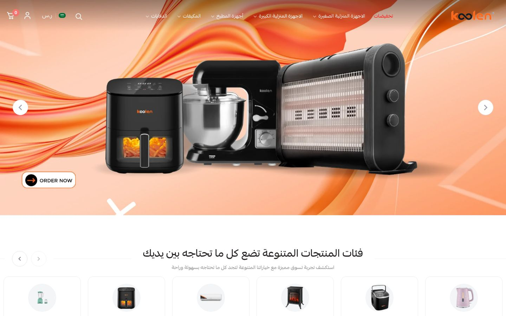
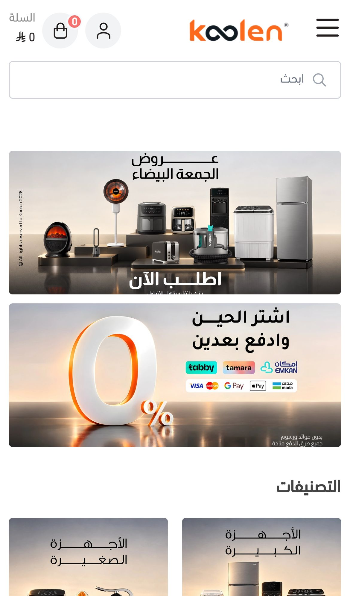
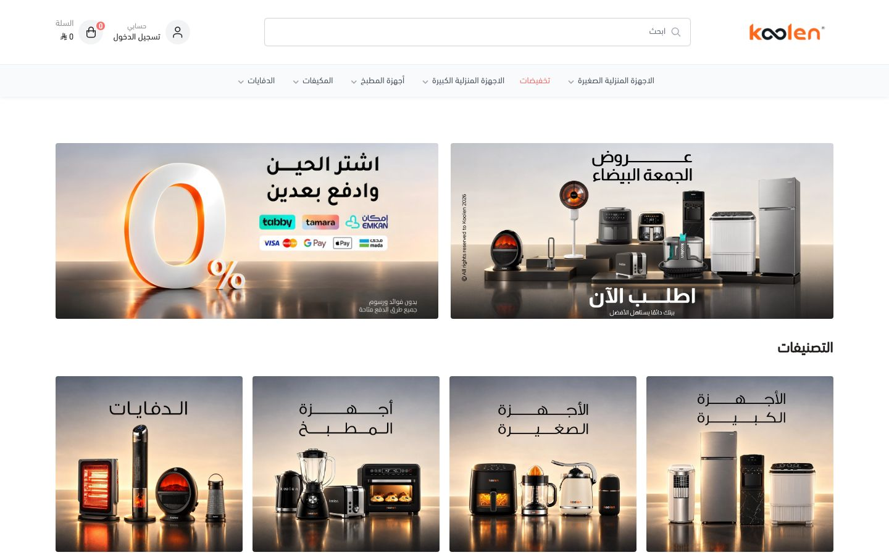

<div align="center">

# KOOLEN

### Arabic (RTL) e-commerce storefront for a Saudi home-appliances brand

Client project for **KOOLEN**, a Saudi brand of small and large home appliances. The store runs in production at **[koolen.com.sa](https://koolen.com.sa)**; this repository holds a static snapshot of its Arabic homepage, published as a portfolio demo.

[](https://developer.mozilla.org/docs/Web/HTML)
[](https://developer.mozilla.org/docs/Web/CSS)
[](https://developer.mozilla.org/docs/Web/JavaScript)
[-004D5A)](https://salla.sa)
[](#overview)
<br>
[](https://eloquent-gelato-190166.netlify.app/)
[](https://koolen.com.sa)

**[Live demo](https://eloquent-gelato-190166.netlify.app/)** ·
**[Production store](https://koolen.com.sa)** ·
**[Portfolio](https://new-portfolio-ashy-xi.vercel.app/)** ·
**[LinkedIn](https://www.linkedin.com/in/eslamraafat-dev/)** ·
**[Email](mailto:eslamraafat736@gmail.com)**

<br>



</div>

<table>
  <tr>
    <td width="33%"></td>
    <td width="67%"></td>
  </tr>
  <tr>
    <td align="center"><sub>Production store on mobile (iPhone 13)</sub></td>
    <td align="center"><sub>Production store on desktop (<a href="https://koolen.com.sa">koolen.com.sa</a>)</sub></td>
  </tr>
</table>

<sub>The large screenshot above is the snapshot in this repo (Netlify demo). The two below are the live production store, whose design has been updated since the snapshot was taken.</sub>

---

## Overview

**KOOLEN** sells home appliances in Saudi Arabia: kitchen appliances, small and large home appliances, air conditioners and heaters. The production store is built on **[Salla](https://salla.sa)**, a Saudi e-commerce platform, and is Arabic-first (`<html lang="ar" dir="rtl">`) with an English version at `/en/`.

This repository is a **client project shared for portfolio purposes**. It contains a single static HTML snapshot of the storefront homepage (`index.html`, from December 2024), so the page can be viewed as a demo outside the live store. Styles, scripts, product images and fonts are loaded from the platform's CDN; there is no build step and no back end in this repo.

## Features

Everything below is visible in the snapshot's markup:

### Storefront

- **Arabic RTL layout** with a language / currency switcher (Arabic, English; SAR).
- **Header** with logo, a multi-level category menu (sales, small appliances, large appliances, kitchen appliances, air conditioners, heaters), search, account login and a cart summary.
- **Homepage blocks:** a hero slider, a category carousel, featured products, a tabbed product slider, best offers, banners, a photo slider, store features and customer testimonials.
- **Product cards** (26 on the page) with price, sale badges, rating stars and a wishlist button.

### Brand and platform

- Brand colour theme set through CSS custom properties (`--color-primary: #ff671d`).
- Platform web components for the menu, search, sliders, cart, login, localization and payment-method icons.
- `Organization` JSON-LD structured data for search engines.

## Tech stack

| Layer | Tools |
| --- | --- |
| Platform | Salla (Twilight theme engine 2.14.35, web components) |
| Markup | HTML5, Arabic RTL |
| Styling | CSS3 with custom properties for the brand colours, PingAR LT font |
| Scripting | JavaScript (theme bundles from the platform CDN) |
| SEO | JSON-LD `Organization` schema, `ar` / `en` alternates |
| Demo hosting | Netlify (also served by GitHub Pages) |
| Production | [koolen.com.sa](https://koolen.com.sa) |

## Project structure

```text
.
├── index.html     # static snapshot of the Arabic storefront homepage
└── cdn-cgi/       # Cloudflare helper files saved with the page (Rocket Loader, RUM)
```

## Getting started

No install or build is needed:

```bash
git clone https://github.com/Eslamraafat1/Koolen.git
cd Koolen
npx serve .        # or open index.html in a browser
```

An internet connection is required, because the page loads its styles, scripts and images from the platform CDN.

## Deployment

- **Demo:** [eloquent-gelato-190166.netlify.app](https://eloquent-gelato-190166.netlify.app/) (Netlify), also on [GitHub Pages](https://eslamraafat1.github.io/Koolen/).
- **Production:** [koolen.com.sa](https://koolen.com.sa), hosted on the Salla platform.

## Author

**Eslam Raafat** — Front-End Developer (React / Next.js / TypeScript)

- **Portfolio:** [new-portfolio-ashy-xi.vercel.app](https://new-portfolio-ashy-xi.vercel.app/)
- **LinkedIn:** [linkedin.com/in/eslamraafat-dev](https://www.linkedin.com/in/eslamraafat-dev/)
- **GitHub:** [@Eslamraafat1](https://github.com/Eslamraafat1)
- **Email:** [eslamraafat736@gmail.com](mailto:eslamraafat736@gmail.com)

---

© KOOLEN. Brand name, logo, product images and content belong to KOOLEN. Code shared for portfolio purposes.
